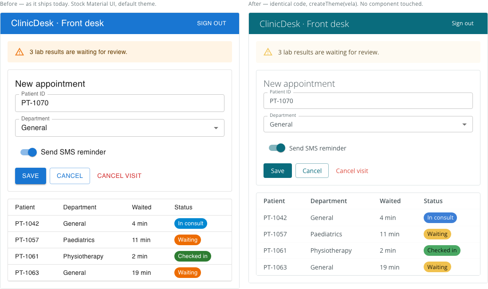
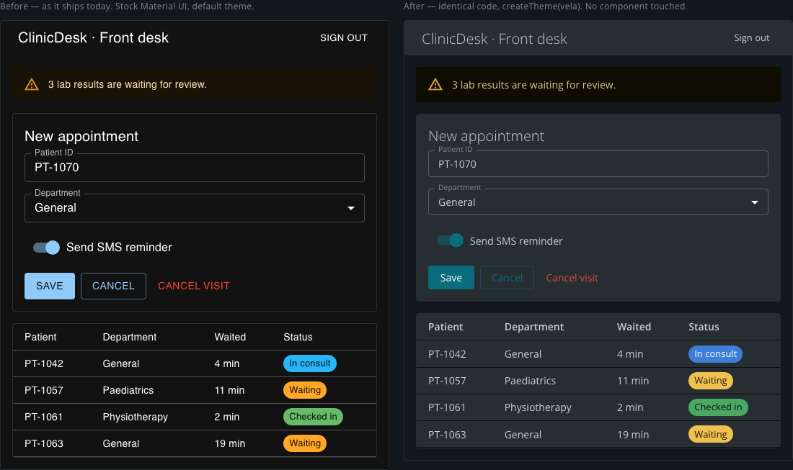

# Vela

[](https://github.com/omkarpkh/vela/actions/workflows/ci.yml)
[](https://www.npmjs.com/package/@omkarux/vela)
[](LICENSE)

A token-first design system. The tokens and the component specs are framework-agnostic;
this repository is a **React implementation** of them. Seventeen components, two themes, zero runtime
dependencies in the core entry — and every design rule in the documentation is tagged with how it is
enforced: 69 of the 212 by the TypeScript compiler, the rest at runtime, in a real browser, or by review
(counted by `npm run rules:check`).

**Status:** every component carries a lifecycle label — Approved, Known bugs, Experimental or
Retired, defined in [`GOVERNANCE.md`](GOVERNANCE.md). Seven are **Approved**; Icon, Text Area, Checkbox,
Radio Group, Popover, Tooltip, Dialog, Table, Toast and Dropdown List are **Experimental**. Every
component's Figma set is published in the library except Dropdown List's, which has a builder and no set yet.

```bash
npm install @omkarux/vela
```

The core entry point, `@omkarux/vela`, has zero runtime dependencies. A second, Experimental
entry point, `@omkarux/vela/headless`, builds the same specs on [Base UI](https://base-ui.com)
and needs one optional peer: `npm install @base-ui/react@1.9` — only if you import from it. Its
first component is Tabs, which ships from both entries (the spec's "Implementations" section says
how the two compare); Checkbox (with Checkbox.Group), Radio Group, the three overlays — Popover,
Tooltip and Dialog (with its `alert` variant) — Toast (`ToastProvider` + `useToast()`) and Dropdown
List were born there and ship from `@omkarux/vela/headless` only.

```tsx
import '@omkarux/vela/styles.css'
import { Button, ContextualAlert, Tabs } from '@omkarux/vela'

<div className="vela-root">
  <ContextualAlert severity="major" title="Scan failed">
    Three assets could not be reached.
  </ContextualAlert>
  <Button variant="primary" appearance="filled">Retry Scan</Button>
</div>
```

**Live:** the overview, the foundations and a playground for every component — controls, tokens,
rules and Figma mapping generated from the same files — at **https://omkarpkh.github.io/vela/**.

**Figma:** the library file is public — [Vela Design System](https://www.figma.com/design/XO2rmeCcgOjyKe4oipgF4j/Vela-Design-System) —
with its variables, component sets and descriptions generated from the same token file and specs.

**How it is made:** https://omkarpkh.github.io/vela/#/how — the token file, its five generated targets with a
link to each, and the number of automated checks, written by the test runners rather than by hand.

## What is actually in here

| | |
|---|---|
| **Components** | Button · Toggle · Input · TextArea · ContextualAlert · StatusIndicator · RiskPill · Tabs · Icon · Table, from `@omkarux/vela` (Tabs also from `/headless`) · Checkbox (with Checkbox.Group) · RadioGroup · Popover · Tooltip · Dialog (with `variant="alert"`) · ToastProvider + useToast · DropdownList, from `@omkarux/vela/headless` only |
| **Tokens** | 285 CSS custom properties, two layers (primitives → semantics) |
| **Themes** | Light + dark. OS preference by default, `data-theme` to override |
| **Dependencies** | None in the core entry. `react` / `react-dom` are peers (18.3 or 19). The `/headless` entry needs one optional peer, `@base-ui/react` 1.9.x (MIT) |
| **Icons** | 50 curated [Lucide](https://lucide.dev) 1.63.0 glyphs (ISC; a subset from Feather, MIT), compiled into the core entry at build time — no icon dependency, `lucide` is a devDependency only. The ISC notice ships in [`NOTICE`](NOTICE) |
| **Format** | ESM, `preserveModules` for tree-shaking, full `.d.ts` |
| **Tests** | 1108 automated checks — 879 unit and contract (98 contrast pairs, each asserted in both themes), 226 browser (68 screenshots at four widths, 156 playground, 2 docs), 3 Flutter — counted by `npm run checks` |
| **Packed size** | 203.9 kB, 217 files (the fifty glyph modules and their .d.ts are most of the growth since 0.12.1), as `npm run verify` measures it (README and CHANGELOG ship in the tarball, so this moves when they do) |

## The three ideas worth stealing

**1. Dark mode redefines no primitive.** The entire dark theme is semantic tokens re-pointed
onto a different part of the same scale. A test fails the build if a raw hex ever appears in
the dark block. That property is what makes a third theme cheap instead of a rewrite.

**2. Severity, Risk and Status are separate taxonomies.** Six levels, three levels, five
states — never interchangeable. There is no "high severity" and no "critical risk". The
types reject both. Most design systems collapse these into one `status` prop and then spend
years untangling it.

**3. Design constraints are compiler errors, not review comments.** `ButtonProps` is a
discriminated union, so the rule "text-link is primary-only, small sizes only, never with an
icon" is not a paragraph someone has to remember:

```tsx
<Button variant="primary" appearance="text-link" size="tiny">Learn More</Button>      // ✅
<Button variant="destructive" appearance="text-link">Delete</Button>                  // ✗ won't compile
<Button variant="primary" appearance="text-link" size="huge">Go</Button>              // ✗ won't compile
<Button variant="primary" appearance="text-link" icon={<Icon />}>Go</Button>          // ✗ won't compile
<ContextualAlert severity="high">…</ContextualAlert>                                  // ✗ severity has no "high"
<StatusIndicator status="critical" />                                                 // ✗ that's severity, not status
<Tabs.List>…</Tabs.List>                                                              // ✗ aria-label is required
<Toggle />                                                                            // ✗ label is required
```

`npm run verify` asserts every one of those rejections against the *published tarball*.

## Adopt without rewrite

The question an acquisition raises is not "can we build a design system" but "can the products we
just bought look like ours without being rebuilt". The demo answers it with a screen built on stock
Material UI, rendered twice from identical component code — the right-hand copy receives one extra
thing, a theme object generated from `tokens/vela.tokens.json`:





```tsx
import { createTheme, ThemeProvider } from '@mui/material/styles'
import vela from '@omkarux/vela/mui-theme.json'
<ThemeProvider theme={createTheme(vela.light)}>{/* the existing app, untouched */}</ThemeProvider>
```

What the theme fixes: colour, type, radius, surfaces, alerts, both modes. What it cannot: Material has
one colour vocabulary, so the status chips wear severity colours — Vela keeps Severity and Status
apart, and that is component work. Theme first, components second, and the demo shows where the line is.

## Visual regression

Unit tests prove behaviour and the contrast audit proves the numbers; neither can see a padding
change break a table. `npm run test:visual` screenshots every component section and both columns
above, light and dark, and compares them with committed baselines (`tests/visual/*-snapshots/`).
Baselines are per platform — the Linux set gates CI, the darwin set serves local runs — and are
updated deliberately with `npm run test:visual:update`, never by hand.

## Accessibility is asserted, not claimed

`npm run contrast` prints every foreground/background pair in both themes against WCAG 2.1
AA — 4.5:1 for text, 3:1 for UI boundaries and non-text signals. The same data backs a test,
so a token change that breaks contrast fails CI.

The first run of that audit found 9 failures in the inherited light palette. All 9 are fixed,
and the fixes are documented in `guidelines/foundations/color.md` so nobody "corrects" them
back — most notably `--vela-btn-destructive-bg`, which binds `red-700` rather than `red-500`
because red-500 behind a white label is 3.93:1.

## Built for agents as well as people

`guidelines/` ships **inside the package**. It is the specification, not a rendered copy of
the source: closed prop tables, token-binding tables, hard constraints, and an anti-patterns
block per component. Point your coding agent at `guidelines/llms.txt`, or import a single
file:

```ts
import buttonSpec from '@omkarux/vela/guidelines/components/button.md?raw'
```

`AGENTS.md` at the repo root carries the same rules for anyone working *on* the system.

## Theming

```tsx
document.documentElement.setAttribute('data-theme', 'dark')   // force dark
document.documentElement.setAttribute('data-theme', 'light')  // force light
document.documentElement.removeAttribute('data-theme')        // follow the OS
```

## Scripts

```bash
npm run dev        # demo showcase at localhost:5174
npm test           # 879 unit and contract tests, of 1108 checks in all — the numbers are generated into demo/checks.json
npm run checks     # counts every automated check into demo/checks.json (diffed in verify)
npm run contrast   # WCAG report for both themes
npm run verify     # tokens:check + icons:check + rules:check + typecheck + tests + checks:check + build + pack-and-consume gate
```

The counts are copied from `demo/checks.json`, which `scripts/count-checks.mjs` writes from the
test runners' own output and `verify` diffs, so that file cannot go stale. This README copy is
checked at each release; the numbers here are for 0.14.0.

## Editing tokens — one source, five targets

`tokens/vela.tokens.json` is the only place a value is written. `tokens/vela.dark.tokens.json` is
an overlay holding only the semantic colours that re-point in dark mode, and
`tokens/vela.resolver.json` says how the two combine. Conforms to DTCG Format, Color and Resolver
Modules 2025.10 (Final CG Reports, 28 Oct 2025); validated in CI with `npm run tokens:validate`.
That check parses all three files with `@terrazzo/parser` 2.10.0 — the one third-party reader
actually tested here, at 0 errors and 0 warnings — then applies Vela's stricter rules (sRGB colour
objects with a matching `hex`, full-path aliases, `{ value, unit }` durations, one vendor key).
Other readers are not claimed until they are tested the same way. The files ship inside the
package as `@omkarux/vela/tokens.json`, `tokens.dark.json` and `tokens.resolver.json`, and
everything else is generated from them:

```bash
npm run tokens:validate # → fails on any DTCG error or warning, and on any legacy shape
npm run tokens          # → tokens.*.css + flutter/lib/vela_tokens.dart (Flutter) + bridges/vela.mui-theme.json (MUI)
npm run tokens:figma    # → a Plugin API script that creates-or-updates every Figma variable
npm run styles:figma    # → a script that creates-or-updates every Figma text style, bound to those variables
npm run components:figma:lint   # builds every component builder in a mock Plugin API and applies the reviewer rules
npm run components:figma:check <name> <live.json>   # diffs the live set against what a rebuild would create
npm run figma:build:pages      # → the library's Changelog and Status pages, compiled from CHANGELOG.md and the specs
npm run tokens:check    # fails if the CSS was hand-edited instead of the JSON (runs in CI)
npm run guidelines:figma # → a script that writes each spec's summary into its Figma description
```

The component specs in `guidelines/` follow the same rule: edit the markdown, and the package,
the agent docs and the Figma descriptions follow. The one thing no script can do is add a
variant — a spec that gains a prop is built in Figma and in code, by people, which is what the
API review is for.

Figma's REST API only lets Enterprise plans write variables, so the Figma half is a generated
script run inside the file (through the Figma MCP or the Scripter plugin). It looks each variable
up by collection and name, so re-running never duplicates: the first run against the live library
reported 0 created / 223 updated, then created the 11 numeric tokens Figma had never had.

## Using it on another stack

Worth being precise about what travels and what doesn't:

| Layer | Ports? |
|---|---|
| **Tokens** (`dist/tokens.css`) | **Entirely.** Plain CSS custom properties — Angular, Vue, Svelte, Rails, plain HTML. |
| **Tokens for Flutter** (`tokens.dart`) | **Entirely.** Generated from the same JSON: the primitives, a `VelaColors` `ThemeExtension` with `light` and `dark`, the sizing scale in logical pixels, the type ramp as `TextStyle`s and `velaThemeData(Brightness)`. Swift, Kotlin or XML would be the same kind of script. Widgets are not generated — they are built against `guidelines/`. |
| **Theme bridge for Material UI** (`mui-theme.json`) | **Entirely.** `createTheme(vela.light)` and a product already built on MUI takes the family look with no component touched — the adopt-without-rewrite path for an acquired product. What it cannot do: keep Severity and Status apart, because Material has one colour vocabulary. That is component work, which is why shared components come second. |
| **The contract** (`guidelines/`) | **Entirely.** Intent, closed prop sets, token bindings, accessibility, anti-patterns. Only the code samples are React-shaped. |
| **Components** (`dist/index.js`) | **No.** One implementation per framework, by definition. |
| **The contrast audit** (`npm run contrast`) | **Entirely.** It parses CSS and knows nothing about React. |
| **Constraints** (`[[rule: … ]]` tags) | **Port as data:** each rule carries its enforcement level. In TypeScript and Dart a compiler rule stays a compiler rule; in Angular, whose template checker cannot relate two inputs, a cross-prop compiler rule becomes lint or runtime. |

So on Angular you would take `tokens.css` and `guidelines/` unchanged, and write the components
against your own idioms — standalone components, signals, `ControlValueAccessor` for form controls.
The closed prop sets become union input types with `strictTemplates` enabled, which buys most of
what the discriminated unions buy here.

This is not a limitation to work around. If an organisation runs more than one framework, no
framework's components can be the source of truth for the others — **the only thing that can be
shared is the contract**, which is the argument this repository exists to make.

So every rule in `guidelines/` is tagged with how it is enforced (compiler, runtime or convention),
and `npm run rules:check` fails the build when a compiler or runtime rule has no proof behind it,
or a new rule arrives untagged.

## Scope

Seventeen components, chosen to exercise every foundation and all three taxonomies (Severity, Risk,
Status), the curated Icon set they draw from, the first form controls born on the headless entry
(Checkbox, Radio Group), the three overlays (Popover, Tooltip, Dialog), Toast, the Dropdown List
and the Table primitives a console's data views are built on. Not yet specced: Select List, Token Pill, Number
Stepper, Icon Button, Actions Dropdown, View Switcher, Data Grid, Card List. The guidelines name
these explicitly so an agent flags the gap instead of inventing one.

## Project files

| File | What it settles |
|---|---|
| [`CONTRIBUTING.md`](CONTRIBUTING.md) | The one path in: spec, tokens, tests, Figma, changelog, PR |
| [`DESIGN.md`](DESIGN.md) | Why the system looks the way it does |
| [`GOVERNANCE.md`](GOVERNANCE.md) | Who decides; the component lifecycle labels; what counts as breaking |
| [`VERSIONING.md`](VERSIONING.md) | Semver for a design system, and the two-minor deprecation window |
| [`RELEASING.md`](RELEASING.md) | The release checklist, in order |
| [`SECURITY.md`](SECURITY.md) | How to report a vulnerability privately |
| [`SUPPORT.md`](SUPPORT.md) | Where to ask, and what is not supported |
| [`CODE_OF_CONDUCT.md`](CODE_OF_CONDUCT.md) | Contributor Covenant 2.1 |
| [`decisions/`](decisions/README.md) | Decision records, indexed, with a template |
| [`NOTICE`](NOTICE) · [`LICENSE-DESIGN.md`](LICENSE-DESIGN.md) | Third-party notices; the Figma library's licence |

## License

MIT for the code, tokens and documentation ([`LICENSE`](LICENSE)). The Figma library is offered
under CC BY 4.0 and additionally under MIT (a Figma Community listing is planned, not yet live); see
[`LICENSE-DESIGN.md`](LICENSE-DESIGN.md).
