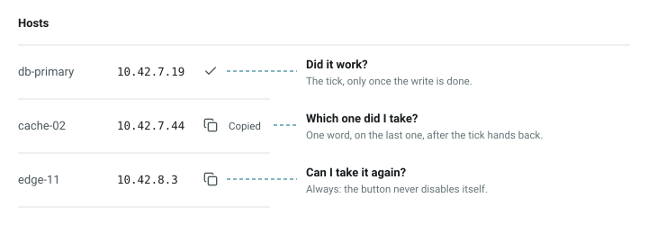
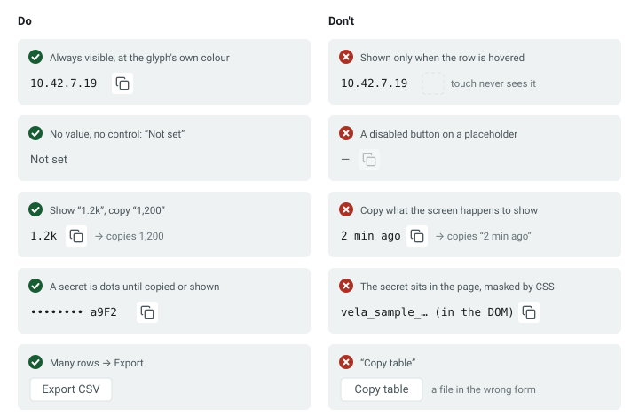
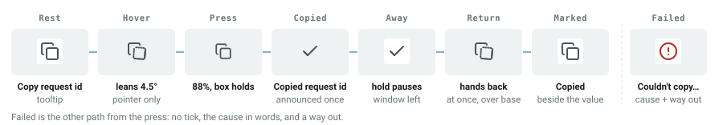
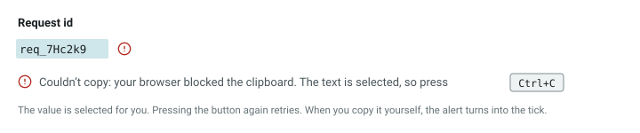
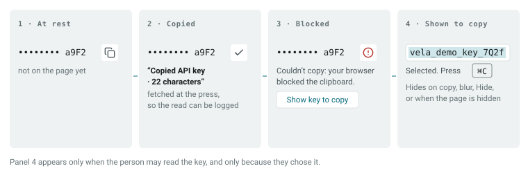
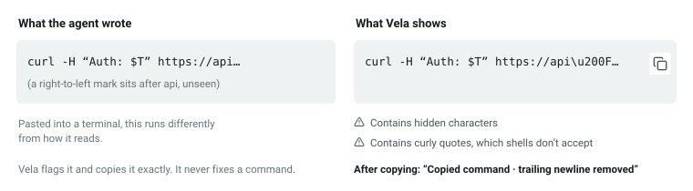
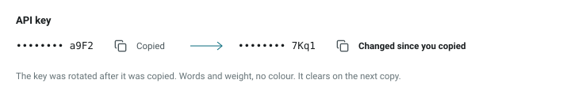
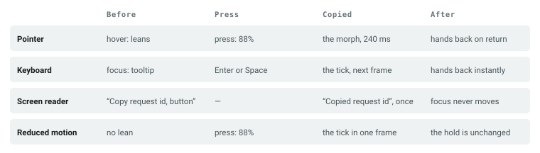
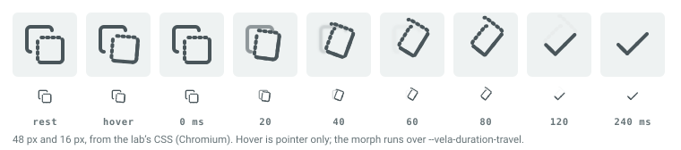

# Copy

Copying a value from a console into another app is one of the most common things a security
analyst does, and one of the least trusted.

The person can't see the clipboard, so the page has to answer three questions for them, without
being asked twice.

*Did it work? Which one did I take? Can I take it again?*

**Limits.** The page:

- can't see the clipboard or clear it;
- can't mark a copied secret as sensitive in clipboard history (W3C clipboard-apis issue 154);
- can't tell where the person pastes.

**Status:** Experimental, a scenario pattern. Not built. **Approved by Omkar, 31 Oct 2026, 17:45 IST.**

- A pattern takes the lowest status of its components: Copy is Experimental until both components below are built, and Stable when both are.
- Pressure-tested by the spec thread.

**Carried out by** (both specified, not yet in `guidelines/components/`):

- **Copy Button**;
- **Copyable Value** and `CopyGroup`.

**Why a pattern, not only a component:** the hardest decisions aren't inside the control. They are:

- who may read a secret;
- where the "last copied" mark lives;
- whether a row is clickable;
- whether the page copies what it shows or what it means.

A component can't make those decisions alone. This page tells the product team, and the agent building the page, how to make them.

---

## 1 · When to offer copy, and when not

| You have | Use |
|---|---|
| A value already on screen, in full, with nothing to track | **Copy Button** beside it |
| Values a person copies one by one (a table, a panel of fields), or a secret, a command, or a value whose display differs from what is copied | **Copyable Value**, inside a `CopyGroup` when there are several |
| A value that is missing, loading, or failed to load | **No control.** It reads "Not set", or shows its own loading or error state |
| A value the person may not read in full | **No control.** A copy is a read |
| Many rows, or a whole table | **An export**, not a copy |
| Long code with lines and syntax | A Code Block: **not in this kit**, so flag the gap. Until then, a Copyable Value with `layout="block"` |

---

## 2 · How it works

- **Rest.** The copy mark, always visible, at the glyph's own colour. Its name says what it copies: "Copy request id", never "Copy".
- **Hover** (pointer only). The front sheet leans 4.5° about its corner: "that one, yes".
- **Press.** The glyph sinks to 88%. The 24 or 35px box never moves.
- **Copied, only once the write has resolved.** The copy mark turns into a tick, and "Copied request id" is announced once, politely.
  - The tick is ink, never green, because beside a status a green tick reads as "healthy".
- **Away.** The tick holds for 1.5s, and **waits for you**: while the page is hidden or the window has lost focus, the hold pauses.
- **Return.** On your return, the tick hands back to the copy mark at once, where you can see it.
- **Marked.** In a group, the word **Copied** stays beside the last value taken. It is the only one on the page, because one clipboard governs the whole page.
- **Failed.** No tick until something is really copied. The cause is given in words, with a way out (section 4).

**Copy again, always.** The button is never disabled by its own success. A press during the hold writes again.

---

## 3 · Words

Every string is whole, built from the object's name (the `label`), in British English.

| Moment | Words | Where |
|---|---|---|
| At rest | Copy request id | name and tooltip |
| Tick showing, pointer or focus arrives | Copy again | tooltip only |
| Copied | Copied request id | announced once |
| Fetching a value | Getting the invite link… | tooltip and description |
| Marked, in a group | Copied | beside the value |
| Marked, in a group | Copied here earlier. Copy again to be sure. | the Copy Button's description |
| A secret copied | Copied API key · 22 characters | announced, and the tooltip while the tick shows |
| A command copied | Copied command · trailing newline removed | as above |
| A multi-line command copied | Copied command · 3 lines | as above |
| Hidden characters found | Contains hidden characters | beside the value, and the button's description |
| Curly quotes or non-breaking spaces | Contains curly quotes, which shells don't accept | as above |
| Changed since copied | Changed since you copied | replaces the mark |
| Changed since copied | This value changed after you copied it. Copy again to get the new one. | the Copy Button's description |
| Blocked, text selected | Couldn't copy: your browser blocked the clipboard. The text is selected, so press Ctrl+C. (⌘C; touch: "tap and hold it, then choose Copy") | announced, and the button's description |
| Blocked, nothing selected | Couldn't copy: your browser blocked the clipboard, so nothing was copied. Select the text and copy it yourself. | as above |
| A secret blocked, may reveal | Couldn't copy: your browser blocked the clipboard. · **Show key to copy** | under the value |
| A secret blocked, may not reveal | Couldn't copy: your browser blocked the clipboard. Try again, or use another browser. | under the value |
| A secret shown to copy | Selected. Press ⌘C to copy. (per platform) | under the field |
| A fetch failed | Couldn't get the invite link, so nothing was copied. Try again. | announced, and the button's description |

**Never:**

- "Copied to clipboard", or "in your clipboard". The page can't see the clipboard; it knows only that its own write succeeded.
- "Copied!" before the write resolves.
- "Copy" alone.

---

## 4 · When it fails

1. **Two tries in one press:** the Clipboard API first, then the older copy command. That second try still works inside embedded apps whose host blocks the first.
2. **If both fail, say the cause, and leave a way out.** The way out depends on whether the value could be selected:
   - "Couldn't copy: your browser blocked the clipboard. The text is selected, so press Ctrl+C."
   - With no selection: "… so nothing was copied. Select the text and copy it yourself."
3. **Use the shortcut for this platform, chosen once at load, in this order:** where there is no fine pointer, "tap and hold it, then choose Copy"; then ⌘C on Apple devices (an iPad with a trackpad gets ⌘C); then Ctrl+C.
4. **When the person copies the selection themselves,** the page sees it and the alert turns into the tick.
5. **A fetched value that fails to arrive** says that instead: "Couldn't get the invite link, so nothing was copied. Try again."

---

## 5 · Secrets

- **A copy is a read.** Offer it only where the person may read the full value. Masked dots are not permission.
- **The secret isn't in the page** until someone copies or shows it. It is fetched at the press, so each read is a real server request the product can log.
- **Eight dots, always,** plus the last few characters the host already shows. The length appears only in the receipt, after a copy.
- **When the copy is blocked,** the way out is the person's choice. **Show key to copy** exists only when they may reveal the key.
- **Show key to copy** shows the key selected, with the shortcut hint. It hides on copy, on blur, on **Hide**, or when the page is hidden.
- **Reading and revealing are separate permissions.** "Show key" without copying is offered as its own button when the person may reveal.
- **Clipboard history** may keep a copied secret, and there is no web way yet to mark it as sensitive (W3C clipboard-apis issue 154). That goes in the product's docs, not the UI.

---

## 6 · Commands

- **A command an agent writes is pasted into a terminal by a person.** Hidden characters can make it run differently from how it reads. The Trojan Source research (CVE-2021-42574) showed exactly that.
- **Vela shows hidden characters as escapes and says so.** It flags curly quotes and non-breaking spaces. It removes one trailing newline, because older shells run it at once, and the receipt says it did.
- **It never fixes a command.** Changing a command changes its meaning.
- **Human text is never checked.** A person's name in another script is not a warning.

---

## 7 · In tables and groups

- **The mark belongs to the group, not the button.** It is keyed by each value's identity (`copyId`), so in a virtualised table it follows its value through scrolling and never lands on a reused row.
- **What clears it:** another copy or cut anywhere on the page, the person's own Ctrl+C, leaving the view, or navigating away.
- **Changed since you copied:** for identifiers, commands and secrets, if the value changes while it carries the mark, the mark says so. For human text it simply clears.
- **Rows aren't clickable.** A row's action is a real link in its first cell, stretched across the row. The cell holding a copy control sits outside that stretch, so people can also select text by hand. The failure path depends on that.

---

## 8 · Everyone gets the same story

- **From the keyboard, nothing animates.** The tick arrives on the next frame, and the hand-back is instant.
- **Focus never moves.** The announcement is polite and made once. The name stays "Copy request id" in every state.
- **Reduced motion:** the morph lands in one frame and there is no lean. The 1.5s hold is a wait, not motion, so it stays.
- **Forced colours:** the glyph follows the system text colour, and every mark is a word, so nothing relies on a background.

---

## 9 · Motion

- **The copy mark becomes the tick.** The front sheet turns about its corner and seats on Vela's spring. The leftover lines retract into the arms, and the back sheet steps back first.
- **It runs over `--vela-duration-travel` (240 ms)** and hands back over `--vela-duration-base`.
- **The full motion table lives in the Copy Button spec.** It needs motion rule 1's icon-stroke exception (`decisions/004-icon-strokes-draw`).
- **Verified** in Chromium (headless, scripted checks), in Safari on macOS (by eye), and on a phone by touch (by eye; the device and browser were not recorded). **Not verified in Firefox.**

---

## 10 · Components used

| Part | Role |
|---|---|
| **Copy Button** (draft) | The control: the morph, the hold, two write paths, the announcement |
| **Copyable Value** and **CopyGroup** (draft) | The value, its kind (`text`, `identifier`, `command`, `secret`), the mark, and the secret and command handling |
| **Icon Button** (draft) | The box, press, tooltip; **Show key** and **Hide key** |
| **Input** (core), read-only | A revealed secret |
| **Tooltip** (core; gains `kind: "label"`) | The name, shown on hover and focus, heard once |
| **Icon** (core) | `circle-alert`, `loader-circle`, `triangle-alert` |
| **Table** (core) | The host; its rows follow the rule in section 7 |
| **Agent Provenance Badge** (proposal) | Beside a value an agent wrote; who wrote it is not the copy control's job |

---

## 11 · Minimum width

**Minimum width: 160px**, Copyable Value's. **Full layout from: 280px.** A Copy Button alone needs only its 24 or 35px box.

---

## 12 · Tests

Both components together carry **34 rules, 27 with proofs**:

- Copy Button: 20 rules, 16 with proofs;
- Copyable Value: 14 rules, 11 with proofs.

The ones this pattern stands on:

| The promise | Rule | Level |
|---|---|---|
| A tick only after a real write | `copy-button-confirms-after-write` | runtime |
| One press, one write, one announcement | `copy-button-one-write-per-press` | runtime |
| Failure says the real cause | `copy-button-fails-honestly` | runtime |
| Nothing animates from the keyboard | `copy-button-keyboard-no-motion` | runtime |
| Frozen end states under reduced motion | `copy-button-reduced-motion-end-states` | browser |
| Retracted strokes leave no dot | `copy-button-strokes-retract-clean` | browser |
| A secret is fetched, never passed | `copyable-value-secret-is-fetched` | compiler |
| The mark follows identity | `copyable-value-mark-by-identity` | runtime |
| Commands are checked, and never changed | `copyable-value-command-checks` | runtime |
| Never "on your clipboard" | `copy-button-no-clipboard-claims` | convention |

`npm run rules:check` keeps this table and the totals above true (`pattern-cites-real-rules`,
`guidelines/patterns/README.md`). Until both components are in `guidelines/components/`, it prints
their rows as "not built yet".

## 13 · Open questions

1. **A parent pattern, "Confirm an invisible result"**, shared with download, undo and refresh. *Proposed:* not until a second case exists.
2. **Firefox.** The morph is unverified there. *Proposed:* the browser rules run in all three Playwright engines before the components' PRs merge.
3. **Figures and the playground's theme switch.** The figures follow the system's light or dark setting, not the playground's switch. *Proposed:* the playground shows live examples; the static figures stay for the repo's Markdown.

<b>Decisions and sources</b>

**Decisions** (icon thread, approved by Omkar, 29 to 30 Oct 2026). These are documents in the claude.ai Project, not in this repository:

- `icons/06`: the screenplay, which found that relief comes at the return, so the lasting mark is a word.
- `icons/06b`: the hold waits for the person; the hand-back follows the input of the copy.
- `icons/07`: the state sweep, including the virtualised-table gap.
- `icons/08` and `08b`: the research check, and the masked-secret fallback.
- `icons/09`: copy is a pattern in four layers; pattern pages are told visually.
- `icons/10` to `17`: the morph, from criteria to the lab.
- `requests/icon-thread-note-table-rows.md`: rows aren't clickable.
- `specs/reviews/copy-pattern-review.md`: the spec thread's pressure test of this page.

**Sources** (read in `icons/08` and `09`):

- GitHub Primer: the Copy scenario pattern and ClipboardCopy.
- GOV.UK Design System: Patterns.
- IBM Carbon: Code snippet.
- MDN: the Clipboard API.
- WebKit: the Async Clipboard API.
- W3C clipboard-apis issue 154.
- OWASP Top 10 for LLM and Agentic Applications.
- Trojan Source (CVE-2021-42574).
- Vercel's interface guidelines, on busy delays.
- WCAG 2.2: 4.1.3, 2.5.8 and 1.4.13.

